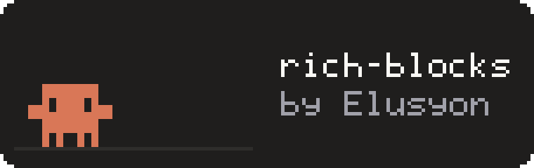
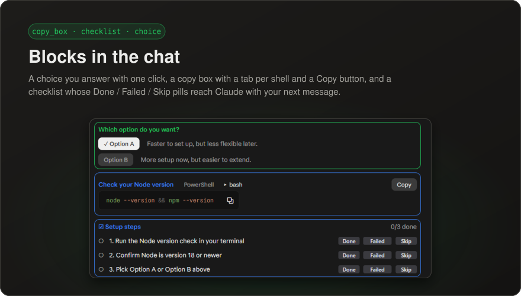
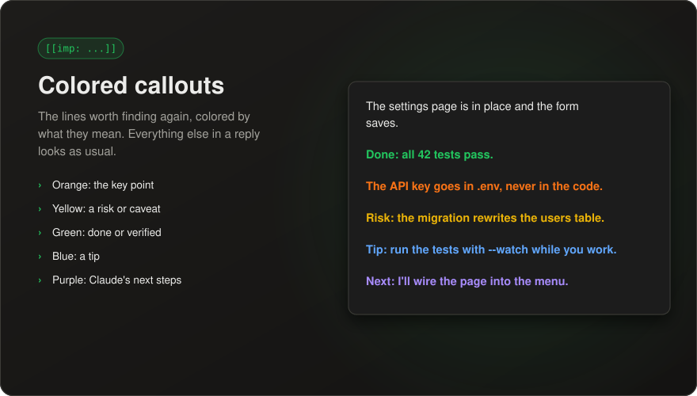
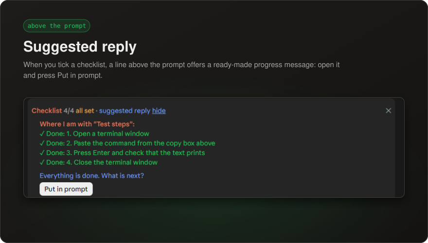
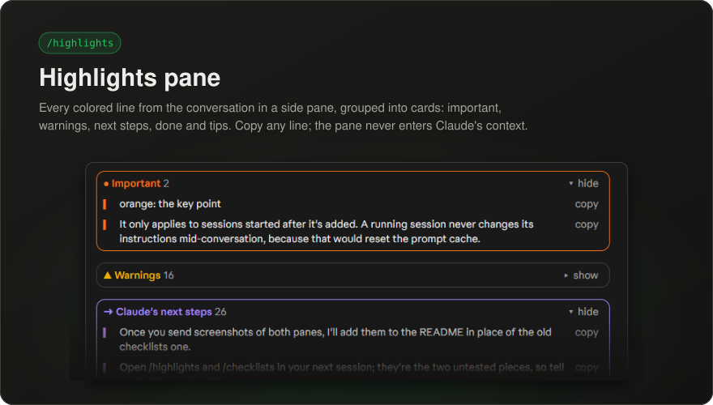
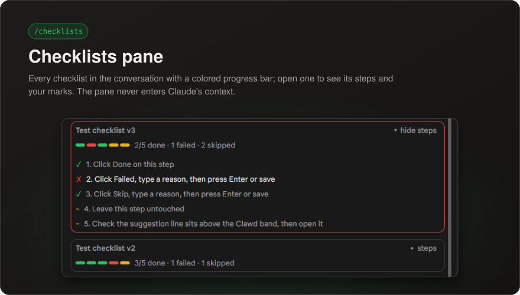
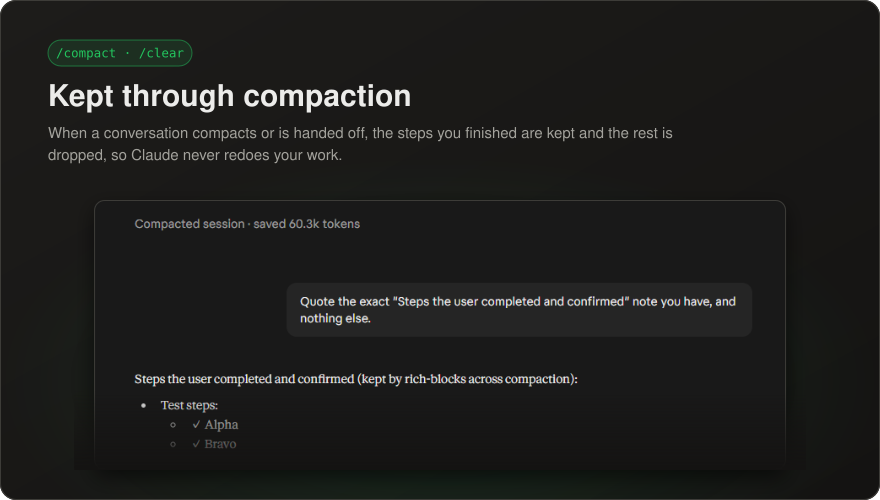

<p align="center">
  
</p>

<h1 align="center">rich-blocks</h1>

<p align="center">
  <b>Interactive blocks for Claude Code.</b><br>
  Copy boxes, checklists, choices and colored highlights, drawn right in the chat.
</p>

<p align="center">
  
  
  
  
</p>

<p align="center">
  <a href="#install">Install</a> ·
  <a href="#features">Features</a> ·
  <a href="#see-it">See it</a> ·
  <a href="#configuration">Configuration</a> ·
  <a href="#token-use">Token use</a> ·
  <a href="#changelog">Changelog</a>
</p>

---

rich-blocks gives Claude a few blocks it draws in the chat instead of plain text: a copy box for anything you paste,
a checklist for the steps you do yourself, a choice when you have to pick, and colored lines for what matters. You
click, tick and copy; Claude sees your progress with your next message.

## Install

**Desktop app:** click **+** next to the prompt box → **Plugins** → **Add marketplace** → `Elusyon117/rich-blocks` →
**Add plugin**.

**Terminal session:**

```
/plugin install rich-blocks --marketplace Elusyon117/rich-blocks
```

Answer `y` to add the marketplace, then pick the user scope to load it in every session. **Shell:**

```bash
claude plugin install rich-blocks --marketplace Elusyon117/rich-blocks
```

Claude picks up the usage guidance in conversations started after install.

**Update** with `claude plugin marketplace update elusyon-rich-blocks`, then
`claude plugin update rich-blocks@elusyon-rich-blocks`, or in the desktop app: **Plugins** → rich-blocks → update.

## Features

| Feature | What it does |
|---|---|
| **Copy boxes** | Commands, configs and snippets in a color-coded box with a **Copy** button; tabs when a command differs by OS or shell. |
| **Checklists** | Steps you do yourself, each with **Done / Failed / Skip** pills and a line for why. Your progress reaches Claude with your next message. |
| **Choices** | 2–4 clickable options with a one-line tradeoff each; your click is sent as your reply. |
| **Colored callouts** | Key lines in Claude's replies colored by meaning, so you can find them again. |
| **Suggested reply** | A line above the prompt that opens to a ready-made progress message, with **Put in prompt**. |
| **`/highlights`** | A side pane with every colored line from the conversation, grouped into cards. |
| **`/checklists`** | A side pane with every checklist, its progress bar and its steps. |
| **Concise style** | Short, on-topic answers that end with next steps when work continues. |
| **Compaction** | When a conversation compacts or is handed off with `/clear`, the steps you finished are kept and the rest is dropped. |

## See it

<p align="center"></p>

<p align="center"></p>

<p align="center"></p>

<p align="center"></p>

<p align="center"></p>

<p align="center"></p>

## Configuration

In the config settings, under **rich-blocks**:

| Option | Values | Default | Effect |
|---|---|---|---|
| Response style | `concise`, `off` | `concise` | `concise` adds the short-answer style; `off` keeps only the block and callout guidance. Applies to new conversations. |

## Token use

Built to stay cheap:

- Claude's guidance is one short section, cached once per conversation.
- Tool descriptions are one line each.
- Checklist progress reaches Claude as one compact line, e.g. `"Install": 1✓ 2✗(needs admin) 3○`, and only for
  checklists in the current conversation.
- Tool results are a few words.
- The panes and the suggestion line never enter Claude's context.

## Requirements

- Claude Code with mods (function-hook plugins), in the desktop app or a terminal.
- Not for `claude -p`, where nothing is drawn.

## Development

```bash
claude plugin validate .
claude plugin test .
```

The README pictures come from `py -I docs/make_cards.py`: one 880×500 card per feature, built from the real
screenshots in [`docs/screenshots/`](docs/screenshots/). Take a new screenshot there and run it again when a block's
look changes.

## License

[MIT](LICENSE): free to use, modify and share, including in your own mods. Keep the copyright notice with copies.

## Changelog

- **1.0.1** MIT license.
- **1.0.0** First stable release: copy boxes with OS/shell tabs, checklists with reasons, choices, colored callouts,
  the suggested reply, `/highlights` and `/checklists` panes, a concise response style, compact token use, and
  completed steps kept through compaction and `/clear` handoffs.

---

<sub>Unofficial fan project, not affiliated with Anthropic. The crab in the logo is drawn in the style of Clawd,
Anthropic's Claude Code mascot.</sub>
