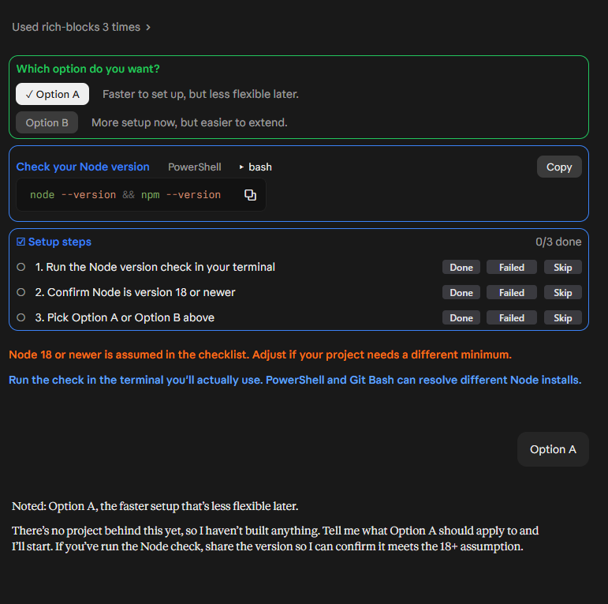
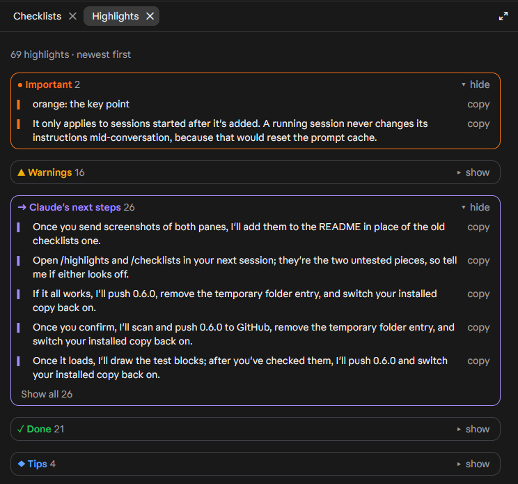
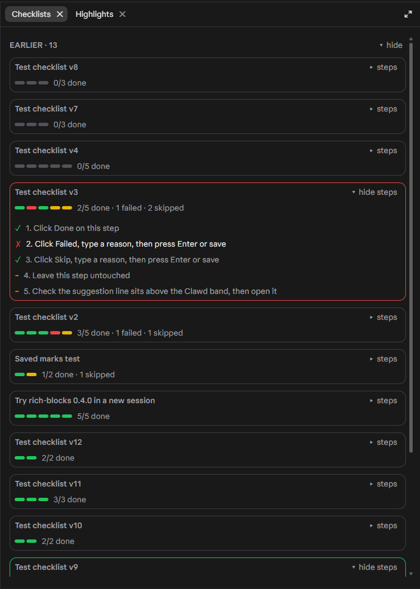

<p align="center">
  
</p>

<p align="center">
  <b>Interactive blocks for Claude Code.</b><br>
  Copy boxes, checklists, choices and colored highlights, drawn right in the chat.
</p>

<p align="center">
  <a href="#install">Install</a> ·
  <a href="#features">Features</a> ·
  <a href="#configuration">Configuration</a> ·
  <a href="#token-use">Token use</a> ·
  <a href="#changelog">Changelog</a>
</p>

---


## Install

**Desktop app:** click **+** next to the prompt box → **Plugins** → **Add marketplace** → `Elusyon117/Elusyon-rich-blocks` → **Add plugin**.

**Terminal session:**

```
/plugin install rich-blocks --marketplace Elusyon117/Elusyon-rich-blocks
```

Answer `y` to add the marketplace, then pick the user scope to load it in every session.

**Shell:**

```
claude plugin install rich-blocks --marketplace Elusyon117/Elusyon-rich-blocks
```

Claude picks up the usage guidance in conversations started after install.

### Update

```
claude plugin marketplace update elusyon-rich-blocks
claude plugin update rich-blocks@elusyon-rich-blocks
```

Or in the desktop app: **Plugins** → rich-blocks → update.

## Features

| Feature | What it does |
|---|---|
| **Copy boxes** | Commands, configs and snippets in a color-coded box with a **Copy** button; tabs when a command differs by OS or shell. |
| **Checklists** | Steps you do yourself, each with **Done / Failed / Skip** pills and a line for why. Your progress reaches Claude with your next message. |
| **Choices** | 2–4 clickable options with a one-line tradeoff each; your click is sent as your reply. |
| **Colored callouts** | Key lines in Claude's replies colored by meaning, so you can find them again. |
| **Suggested reply** | A line above the prompt that opens to a ready-made progress message, with **Put in prompt**. |
| **`/highlights`** | A side pane with every colored line from the conversation, grouped into cards. |
| **`/checklists`** | A side pane with every checklist, its progress bar and its steps. |
| **Concise style** | Short, on-topic answers that end with next steps when work continues. |
| **Compaction** | When a conversation compacts or is handed off with `/clear`, the steps you finished are kept and the rest is dropped. |

### Blocks in the chat

A choice (the pick is sent as your reply), a copy box on its bash tab, a checklist, and two callouts:



### Colored callouts

Claude marks the lines worth finding again. Only the drawing changes; paragraphs without a marker look as usual.

| Color | Meaning |
|---|---|
| 🟠 Orange | The key point |
| 🟡 Yellow | A risk or caveat |
| 🟢 Green | Done or verified |
| 🔵 Blue | A tip or suggestion |
| 🟣 Purple | Claude's next steps |

### Side panes

Open them with `/highlights` and `/checklists`. They never enter Claude's context, so they cost no tokens.

<p>
  
  
</p>

### Suggested reply

Collapsed to one line above the prompt until you click **show**:


### Compaction

After `/compact`, Claude still has the steps you finished, and only those:


## Configuration

In the config settings, under **rich-blocks**:

| Option | Values | Default | Effect |
|---|---|---|---|
| Response style | `concise`, `off` | `concise` | `concise` adds the short-answer style; `off` keeps only the block and callout guidance. Applies to new conversations. |

## Token use

Built to stay cheap:

- Claude's guidance is one short section, cached once per conversation.
- Tool descriptions are one line each.
- Checklist progress reaches Claude as one compact line, e.g. `"Install": 1✓ 2✗(needs admin) 3○`, and only for checklists in the current conversation.
- Tool results are a few words.
- The panes and the suggestion line never enter Claude's context.

## Requirements

- Claude Code with mods (function-hook plugins), in the desktop app or a terminal.
- Not for `claude -p`, where nothing is drawn.

## Development

```
claude plugin validate .
claude plugin test .
```

## Changelog

- **1.0.0** First stable release: copy boxes with OS/shell tabs, checklists with reasons, choices, colored callouts, the suggested reply, `/highlights` and `/checklists` panes, a concise response style, compact token use, and completed steps kept through compaction and `/clear` handoffs.

---

<sub>Unofficial fan project, not affiliated with Anthropic. The crab in the logo is drawn in the style of Clawd, Anthropic's Claude Code mascot.</sub>
