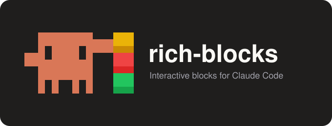
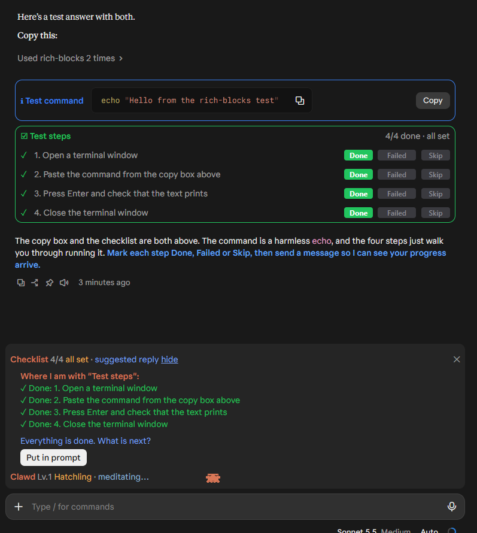
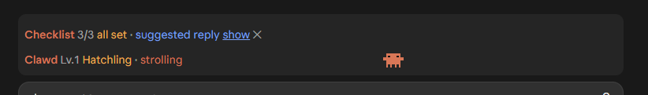
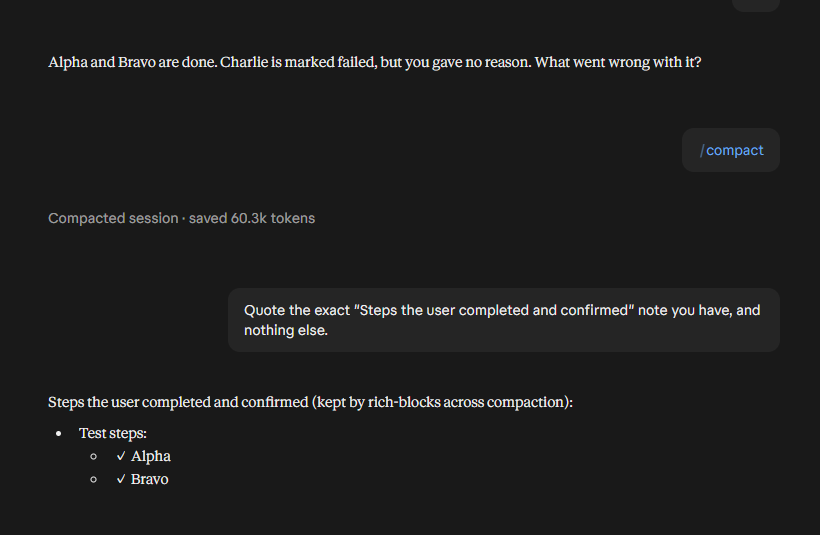

<p align="center"></p>

# rich-blocks

A Claude Code mod that makes Claude's answers easier to act on.



- **Copy boxes:** commands, configs and snippets in a color-coded box with a Copy button.
- **Checklists:** steps you do yourself, each with Done / Failed / Skip pills and a line for why a step failed or was skipped. Your progress reaches Claude with your next message.
- **Suggested reply:** a line above the prompt that opens to a ready-made progress message, with **Put in prompt**.
- **Colored callouts:** key lines in Claude's replies colored by meaning: orange (important), yellow (warning), green (done), blue (tip), purple (Claude's next steps).
- **Concise style:** short, on-topic answers that end with next steps when work continues. Switch it off in the config settings (Response style: `off`).
- **Compaction:** when a conversation compacts (or is handed off with `/clear`), the steps you marked Done are kept and the rest is dropped.

### Suggested reply

Collapsed to one line above the prompt until you click **show**:



### Compaction

After `/compact`, Claude still has the steps you finished, and only those:



Works in the Claude Code desktop app and terminal. Requires a Claude Code build with mods (function-hook plugins).

Unofficial fan project, not affiliated with Anthropic. The crab in the logo is drawn in the style of Clawd, Anthropic's Claude Code mascot.

## Install

At the prompt of a terminal session:

```
/plugin install rich-blocks --marketplace Elusyon117/Elusyon-rich-blocks
```

Answer `y` to add the marketplace, then pick a scope (user scope loads it in every session).

From a shell:

```
claude plugin install rich-blocks --marketplace Elusyon117/Elusyon-rich-blocks
```

In the desktop app, where `/plugin` does not run: click **+** next to the prompt box, then **Plugins**, **Add marketplace** with `Elusyon117/Elusyon-rich-blocks`, then **Add plugin**.

The usage instructions reach Claude in conversations started after install.
